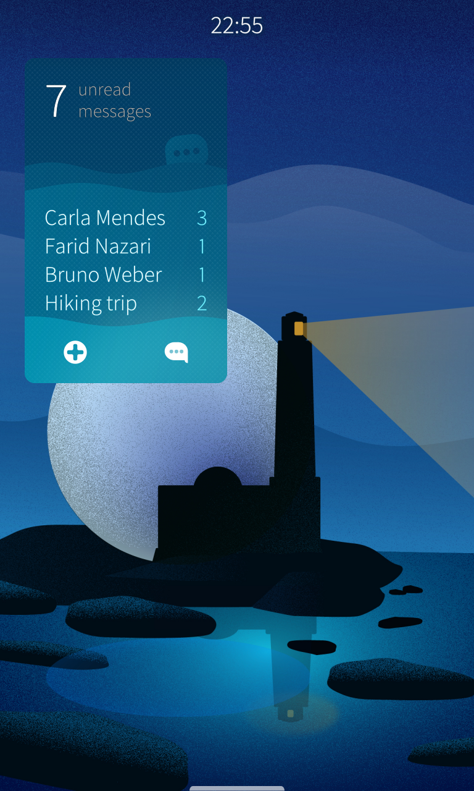

# Threesea

**An unofficial [Threema](https://threema.ch) client for Sailfish OS.** Native, private, no Google.

[](https://github.com/penttimus/harbour-threesea/actions/workflows/ci.yml)
[](https://github.com/penttimus/harbour-threesea/releases/latest)
[](https://github.com/penttimus/harbour-threesea/releases)
[](#install)
[](#install)
[](LICENSE)

<picture>
  <source media="(prefers-color-scheme: dark)" srcset="docs/assets/ai-generated-white.svg">
  
</picture>

- 💬 **Threema on your Sailfish phone**: chats, groups, calls, Threema Desktop and Web
- 🔒 **Threema's own protocol library** (`libthreema`), encrypted storage, no telemetry
- 🐟 **Feels like Jolla's apps**: Silica UI, pulley menus, cover, notifications
- 🔑 **Needs a Threema Libre license key** from the [Threema Shop](https://shop.threema.ch)

> [!IMPORTANT]
> Threesea is **made with AI**, **comes with no warranty**, and is **not affiliated with Threema**.
> Please read the [disclaimer](#disclaimer) before you use it.

## Screenshots

<table>
<tr>
<td></td>
<td></td>
<td></td>
<td></td>
</tr>
<tr>
<td></td>
<td></td>
<td></td>
<td></td>
</tr>
</table>

<sub>Made-up demo data from the emulator ([versions](docs/screenshots/README.md)).</sub>

## Install

### With Harpoon (recommended)

[Harpoon](https://github.com/JuhaniLehtimaeki/Harpoon) installs apps straight from their GitHub
releases and keeps them up to date, picking the right package for your phone
([forum thread](https://forum.sailfishos.org/t/obtainium-like-installer-for-sailfish-harpoon/34515)).


1. Install Harpoon from its [latest release](https://github.com/JuhaniLehtimaeki/Harpoon/releases/latest)
   (Sailfish OS 5.0+, allow untrusted software in Settings).
2. In Harpoon, add an app: **scan the QR code**, or paste
   `https://github.com/penttimus/harbour-threesea`.
3. Pick **full** when Harpoon asks which build you want (see [below](#full-or-lite)). Releases
   up to 0.3.1 name their files so that it can't ask: in the same dialog, set
   **Package filter (regular expression)** to `full` (or `lite`). The filter keeps working later.

That's it: new versions come to you through Harpoon. From the release after 0.3.1 on it also
recognises a Threesea you installed by hand, and shows its icon.

### By hand

Download the RPM for your phone from the [releases](https://github.com/penttimus/harbour-threesea/releases/latest)
(`aarch64` for current phones, `armv7hl` for older ones) and open it on the phone
([details](docs/release.md#installing-a-release-on-a-phone)). Every release is built by GitHub
Actions from the tagged source, with checksums and [build attestations](SECURITY.md#verifying-a-release).

### Full or Lite?

|  | **Full** (recommended) | **Lite** |
|---|---|---|
| Messages arrive | always, connects at login | while Threesea runs |
| Calls (1:1 and group) | ✅ | — |
| Voice messages at the ear | ✅ | — |
| Follows the Jolla Store's rules | — | ✅ |

Install one of the two ([why](docs/decisions/0014-lite-full-github-updates.md)).

## Features

- **Chats**: 1:1 with Perfect Forward Secrecy, groups, distribution lists, mentions, receipts,
  typing, quotes, reactions, edit, delete, polls, text formatting, emoji with search
- **Media**: photos (crop, rotate, draw), videos, files, voice messages, GIFs, locations
- **Calls**: 1:1 and group, audio and video *(Full)*
- **Devices**: Threema for Desktop (multi-device), Threema Web
- **Your ID**: license check, new ID, ID backup (text or QR), Threema Safe, Android data backups
- **Privacy**: app lock, private chats, encrypted storage (SQLCipher), opt-in hashed address book
  matching, spam reports
- **Sailfish**: notifications with quick reply, cover, background connection, sharing,
  `threema://` links
- **Organise**: archive, pinned chats, mark as unread, search, starred messages, auto-delete,
  chat export
- **Languages**: English, German, French, Finnish

Not fully tested yet: calls on a phone, a data backup restored on Android, and a complete spam
report. What's new is in the [CHANGELOG](CHANGELOG.md).

<details>
<summary><b>What Threesea connects to</b></summary>

Only Threema's servers: chat, directory, blobs, Threema Safe, the multi-device mediator, calls,
Threema Web and the map server. Two exceptions, both only if you say yes:

- **Update check** (GitHub builds): once a day asks GitHub for the newest version. GitHub sees your
  IP address and the app version, nothing else. Asked once, off unless you agree.
- **Self-hosted Threema Web servers**: asked before the first use, listed under Threema Web.

</details>

<details>
<summary><b>Forgot your app lock PIN or passphrase?</b></summary>

This deletes the chats and media on this phone. What comes back is what your backups hold.

1. Delete `~/.local/share/org.threesea/harbour-threesea`.
2. Restart the phone (Threesea keeps running in the background otherwise).
3. Open Threesea, enter the license key and restore your ID from Threema Safe, an ID backup or a
   data backup.

With "Encrypt stored data" on, Threesea asks for that passphrase first. Nothing else gets past it.

</details>

## Disclaimer

- **Made with AI.** Developed with [Claude Code](https://claude.com/claude-code) (Anthropic) and
  audited with [OpenAI Codex](https://openai.com/codex/), directed and tested by a human
  maintainer. A research and experimentation project.
- **No warranty.** AI makes mistakes, also in security-relevant code. You use Threesea at your own
  risk (sections 15 and 16 of the [license](LICENSE)).
- **Unofficial.** Not affiliated with, endorsed or supported by Threema AG: please ask for help
  here, not there. Threesea plays fair: it needs a license from the Threema Shop, checks it like
  Threema's apps, and names itself to Threema's servers. Threema told us (November 2026) that it
  doesn't actively block third-party apps that cause no trouble, are clearly unofficial and don't
  get around the licensing. That isn't a permission, and it can change.
- **Keep a backup of your ID**, as with any Threema app.

## Contributing

Bug reports and pull requests are welcome in the [issues](https://github.com/penttimus/harbour-threesea/issues).

Everything the AI was told and learned is in the repository, so anyone can pick up the work:
[CLAUDE.md](CLAUDE.md) is the standing brief, [docs/](docs) has the decisions, protocol notes,
audits and the [status log](docs/STATUS.md). `scripts/check.sh` runs all checks.

Build with Docker ([details](docs/build.md)):

```sh
git clone --recurse-submodules --shallow-submodules https://github.com/penttimus/harbour-threesea
cd harbour-threesea && scripts/sdk-build.sh aarch64
```

## Contributors

<!-- contributors: written by scripts/make-contributors.py from contributors.json -->
- **[penttimus](https://github.com/penttimus)**, since 27 October 2026
- **[jmpx448](https://github.com/jmpx448)**, since 8 November 2026
<!-- /contributors -->

## Credits

Threesea stands on the work of others. Thank you!

- **[Threema AG](https://threema.ch)**: [threema-android](https://github.com/threema-ch/threema-android)
  and `libthreema` (AGPL-3.0, vendored with our changes), the protocols of Threema, Threema for
  Desktop and Threema Web, and the emoji search terms (likely from the
  [Unicode CLDR](https://cldr.unicode.org/), Unicode License v3)
- **[Twemoji](https://github.com/jdecked/twemoji)**: emoji graphics (CC-BY 4.0)
- **[opus-pure](https://crates.io/crates/opus-pure)** by Stephen Berry, from Rust ports of
  [libopus](https://opus-codec.org/) (BSD-3-Clause): voice messages
- **[webrtc-audio-processing](https://gitlab.freedesktop.org/pulseaudio/webrtc-audio-processing)**
  (BSD-3-Clause): echo cancellation in calls
- **[MapLibre Native](https://github.com/maplibre/maplibre-native)** and its
  [Qt bindings](https://github.com/maplibre/maplibre-native-qt) (BSD-2-Clause), with **rinigus**'
  [mapbox-gl-qml](https://github.com/rinigus/mapbox-gl-qml) (LGPL-3.0) and
  [pkg-maplibre-gl-native](https://github.com/rinigus/pkg-maplibre-gl-native) (MIT): the map,
  bundled at the [versions](scripts/maplibre/versions) and with the [patches](scripts/maplibre/patches) in this repository
- **[OpenMapTiles](https://openmaptiles.org/)** and
  **[OpenStreetMap](https://www.openstreetmap.org/copyright) contributors** (ODbL): map data, served
  by Threema
- **[Jolla](https://jolla.com) and Sailfish OS**: Silica, the theme icons, and Jolla's apps as the
  model for the UI
- **[Whisperfish](https://gitlab.com/whisperfish/whisperfish)**: the reference for a Rust app on
  Sailfish OS
- **[SQLCipher](https://www.zetetic.net/sqlcipher/)**, **[GStreamer](https://gstreamer.freedesktop.org/)**,
  **[Qt](https://www.qt.io/)** and the Rust crates in [Cargo.lock](Cargo.lock)
- The **"AI generated" label** is the European Commission's icon for AI-generated content

## License

[AGPL-3.0-only](LICENSE), like threema-android. The bundled libraries' licences are in
[THIRD-PARTY-NOTICES.txt](THIRD-PARTY-NOTICES.txt). The app shows both under Settings → About.
